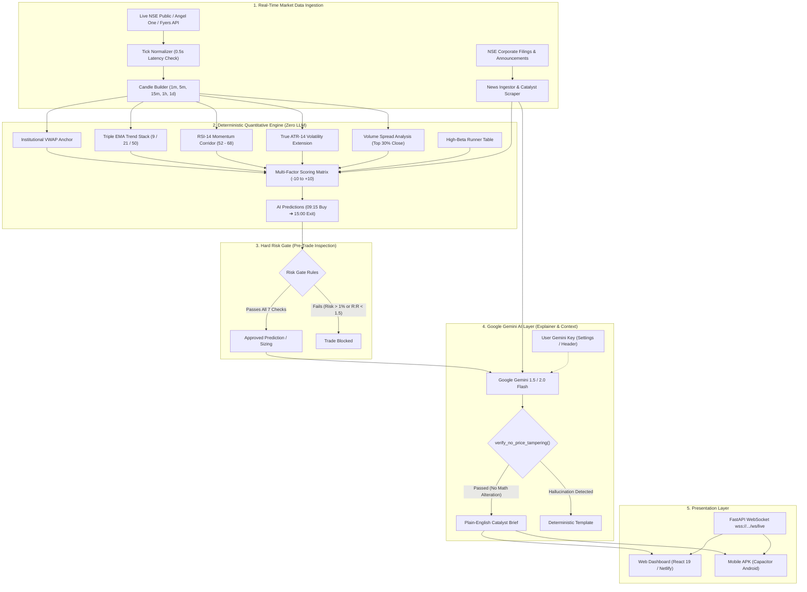

# AI Trade Assist - System Architecture & AI Integration Guide

## 1. System Overview & Philosophy

**AI Trade Assist** is a high-performance, institutional-grade decision-support system for the National Stock Exchange of India (NSE). It is designed around a fundamental quantitative principle:

> **Math Calculates. Rules Protect. AI Explains.**

* **The Quantitative Engine** computes mathematical levels (VWAP, EMAs, RSI, ATR, RVOL, Position Sizing).
* **The Hard Risk Gate** acts as an unbreakable firewall (1% capital risk, 3% daily loss limit, min 1:1.5 R:R).
* **Google Gemini (LLM)** synthesizes market context, reads breaking corporate filings, and explains the trade rationale in plain English.

---

## 2. High-Level Architecture Diagram



---

## 3. How Predictions & Suggestions Are Generated

The predictions displayed in the **AI Predictions** tab are calculated deterministically every market cycle.

### A. The 5 Pillars of the 09:15 AM $\to$ 15:00 PM Strategy
1. **Institutional VWAP Anchor (+3 / -3 pts)**:
   * VWAP is the volume-weighted average price where institutions build positions. 
   * When price trades firmly above VWAP, institutions are buyers. When below VWAP, sellers dominate.
2. **Intraday Trend Velocity (+2 / -2 pts)**:
   * Evaluates the 9-period EMA against the 21-period EMA. A bullish alignment ($9 > 21$) confirms sustained directional momentum.
3. **Triple Moving Average Alignment (+2 / -2 pts)**:
   * Price $> \text{EMA 9} > \text{EMA 21} > \text{EMA 50}$ indicates an ideal structural trend stack with zero moving average resistance.
4. **Volume Spread Analysis (VSA Absorption) (+1.5 / -1.5 pts)**:
   * Inspects the 5-minute candle closing location:
     $$\text{Close Location} = \frac{\text{Close} - \text{Low}}{\text{High} - \text{Low}}$$
   * A close in the **top 30% of the candle** proves institutional demand absorbed all selling pressure before the close.
5. **High-Beta Elasticity & Relative Volume (+2 pts)**:
   * Prioritizes high-beta runners (e.g. Tata Steel $\beta=1.62$, Bajaj Finance $\beta=1.52$, SBI $\beta=1.38$) that provide larger intraday percentage expansion vs NIFTY 50.
   * Requires volume to exceed $1.2\times$ the 20-period moving average.

### B. Mathematical Target & Stop-Loss Calculation
* **Target (15:00 Exit)**: Calculated using the stock's **True ATR-14 (Average True Range)** multiplied by its beta factor. This ensures targets represent realistic, achievable daily volatility spreads rather than arbitrary numbers.
* **Stop Loss**: Anchored strictly to structural support (Session VWAP, 21 EMA, or Opening Range Midpoint).
* **Execution Timeline**:
  * **09:15 AM**: Buy on opening range confirmation. Place initial hard stop loss.
  * **11:30 AM**: Once a $+1.0\%$ gain is achieved, trail the stop loss to breakeven or VWAP.
  * **15:00 PM**: Exit and square-off before broker MIS auto-square-off charges.

---

## 4. Why an LLM is NOT Used for Math or Price Prediction

A common misconception in retail trading is that an AI should "predict tomorrow's stock price". In professional finance, this is strictly avoided for three critical reasons:

### 1. The Hallucination Hazard
Large Language Models (like GPT, Gemini, or Claude) are statistical text predictors trained to generate probable sequences of words. When asked to compute numbers or technical indicator values, LLMs frequently **hallucinate**:
* They can invent arbitrary support/resistance levels that do not exist on the chart.
* They struggle with exact floating-point arithmetic required for risk-to-reward ratios and lot sizing.

### 2. Lack of Deterministic Execution
If you ask an LLM the same question twice, temperature and sampling can yield two different price targets. A regulated financial decision system must be **100% deterministic and reproducible**:
* An EMA 21 at ₹1,420.50 must *always* be ₹1,420.50.

### 3. Latency & Rate Limits
A quantitative engine needs to calculate hundreds of ticks and candles every second with sub-100ms latency. Sending raw candle numbers to an LLM cloud API on every tick is too slow and cost-prohibitive.

---

## 5. Which LLM is Used and What Does It Do?

We use **Google Gemini (Gemini 1.5 Flash / Gemini 2.0 Flash / Gemini 1.5 Pro)**. 

Gemini was selected because:
* **Speed**: Gemini 1.5 Flash delivers sub-second response times ideal for live market analysis.
* **Large Context Window**: Up to 1,000,000+ tokens to digest complex corporate disclosures.
* **Free Tier Accessibility**: Available for free through [Google AI Studio](https://aistudio.google.com/app/apikey) without requiring a paid credit card.

### Gemini's Exact Roles in the System:
1. **Live Corporate Disclosures & Catalyst Sentiment**:
   * Scans breaking NSE filings, earnings results, and exchange news.
   * Assigns a sentiment rating and flags positive catalysts (e.g. big order wins) or negative landmines (e.g. regulatory probes).
2. **Plain-English Trade Rationales**:
   * Takes the raw math (Entry ₹1,240, Target ₹1,288, VWAP ₹1,232, RVOL 1.6x) and drafts an executive summary for the trader.
3. **Double-Checked Guardrail (`verify_no_price_tampering()`)**:
   * Every text response from Gemini is inspected by code before reaching your screen. If Gemini alters or invents any price number, it is instantly discarded.

---

## 6. How Users Can Connect Their Own Gemini API Key

You can connect your own free Google Gemini API key through two methods:

### Method 1: Directly in the Web App / Android APK (Recommended)
1. Open the app and click the **Settings icon (⚙️)** in the top right header.
2. In the **Google Gemini AI Access** box, paste your API key (starts with `AIzaSy...`).
3. Click **"Test AI"**: The app sends a live ping to verify the key and shows `✓ Connected to Google Gemini (gemini-1.5-flash)!`.
4. Click **"Save Settings"**. Your key is securely stored in your local browser/device storage and passed via the `X-Gemini-API-Key` header for real-time analysis.

### Method 2: In Environment Variables (Backend / Render)
1. Open your `.env` file or [Render Dashboard](https://dashboard.render.com).
2. Add the variable:
   ```env
   GEMINI_API_KEY=AIzaSyYourActualKeyHere
   GEMINI_MODEL=gemini-1.5-flash
   ```
3. Restart or redeploy the backend. The backend will automatically use this key as the global fallback for all users.

---

## 7. How to Get a Free Google Gemini API Key
1. Go to [**aistudio.google.com/app/apikey**](https://aistudio.google.com/app/apikey).
2. Log in with any Google account.
3. Click **"Create API Key"** and select **"Create in new project"**.
4. Copy the generated key and paste it into the **Settings** modal in your app.
